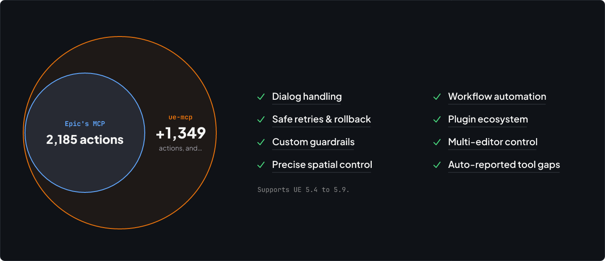

# UE-MCP

[](https://www.npmjs.com/package/ue-mcp)
[](https://www.npmjs.com/package/ue-mcp)
[](https://github.com/db-lyon/ue-mcp/actions/workflows/ci.yml)
[](LICENSE)
[](https://discord.gg/YdgPrQkUEX)

**Let an AI agent work inside your Unreal Editor.** Ask in plain English, and it builds levels, Blueprints, materials, VFX, landscapes and more in your open project.



UE-MCP is a free, open-source [Model Context Protocol](https://modelcontextprotocol.io) server for Unreal Engine 5. It connects AI assistants like Claude, Cursor and Codex to the editor through <!-- count:actions -->3527+<!-- /count --> actions, including Epic's native Unreal 5.8 tools.

```
"Place a point light 300 units above the player start, warm white, intensity 5000."
"Create a pulsing emissive material and apply it to every cube in the level."
"Build the project in Development and tell me about any compile errors."
```

## Two ways to use it

### 1. UE-MCP Studio: a chat agent in the editor

https://github.com/user-attachments/assets/24d4fc16-e6b4-4dc7-98ea-eaf4798923b1


[**Studio**](https://ue-mcp.com/docs/studio) is a free desktop client with the agent built in. Dock it in the editor or run it in its own window. Sign in with your Claude or ChatGPT account, or use an API key. Every turn is checkpointed so you can review and revert changes, and shell commands and file edits wait for your approval.

Download the editor plugin from [its latest release](https://github.com/db-lyon/ue-mcp-studio-plugin/releases/latest), unzip it into your project's `Plugins` folder, and open Studio from the toolbar. Studio sets up everything else. Windows, UE 5.7 and 5.8.

### 2. Bring your own AI client

Already using Claude Code, Claude Desktop, Cursor or Codex? From your project folder:

```bash
npx ue-mcp init
```

The wizard installs the bridge plugin into your project and configures your AI client. Open the editor (the bridge compiles on first launch), then ask your AI to run `project(action="get_status")` to confirm it is connected.

Full walkthrough: [Getting Started](https://ue-mcp.com/docs/getting-started).

## What can it do?

Almost anything you do by hand in the editor: levels and actors, Blueprints, materials, assets and imports, animation and Control Rig, Niagara, landscape, foliage, PCG, audio, UMG, gameplay systems, GAS, StateTree, networking, Sequencer, builds and PIE.

Beyond single actions, it can chain steps into reusable [flows](https://ue-mcp.com/docs/flows) with rollback, handle editor dialogs, drive several editors at once, and be extended with [ue-mcp plugins](https://plugins.ue-mcp.com).

To see it build a full scene from nothing, run the built-in [Neon Shrine demo](https://ue-mcp.com/docs/neon-shrine-demo).

## FAQ

**What is "MCP"?**

Model Context Protocol is an open standard that lets AI assistants call external tools. UE-MCP is the tool server that gives them the Unreal Editor.

**Does it cost anything?**

No. UE-MCP and Studio are MIT-licensed and free for personal and commercial use. You pay only for your AI model, through your existing plan or API key.

**Which Unreal versions and platforms?**

UE 5.4 to 5.8 on Windows, 5.6+ on macOS and Linux. Studio is Windows-only for now, on UE 5.7 and 5.8. You also need Node.js 20+ and a C++ toolchain, since the bridge plugin compiles in your project.

**Is it safe to let an AI edit my project?**

Write guards can block or require confirmation for changes, source-controlled assets can be protected, and flows roll back on failure. Studio adds per-turn checkpoints and approval prompts. Use source control regardless.

**Does it work without the editor open?**

Partly. Config, C++ headers and asset listings can be read with the editor closed. Anything that changes the project needs the editor running.

**How is this different from Epic's built-in AI tools?**

UE-MCP wraps Epic's native UE 5.8 tools and adds over a thousand of its own, plus flows, guards and plugins. See the [comparison](https://ue-mcp.com/compare) against Epic and other Unreal MCP servers.

**It won't connect / something isn't working.**

Run `npx ue-mcp doctor`, check out the [Troubleshooting Guide](https://ue-mcp.com/docs/troubleshooting), or come give me a shout in the [official ue-mcp discord](https://discord.gg/YdgPrQkUEX)!!!

## Learn more

- [Documentation](https://ue-mcp.com/docs) and [Tool Reference](https://ue-mcp.com/docs/tool-reference)
- [Studio source](https://github.com/db-lyon/ue-mcp-studio)
- [Discord](https://discord.gg/YdgPrQkUEX)
- Custom tooling, air-gapped installs or managed relay: hello@ue-mcp.com

## Contributing

Issues and pull requests are welcome. Start with [Development](https://ue-mcp.com/docs/development). Install [git-lfs](https://git-lfs.com) before cloning, because the test project stores assets through LFS.

If UE-MCP helps your work, [sponsorship](https://github.com/sponsors/db-lyon) is appreciated.

## License

[MIT](LICENSE). Contributions are accepted under the same license.