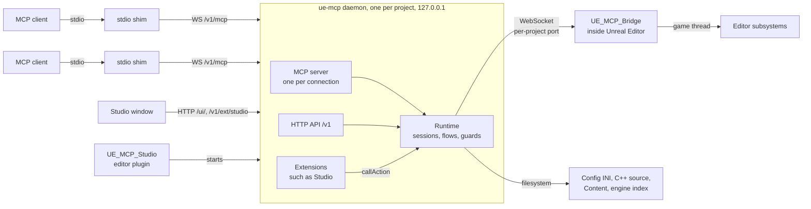
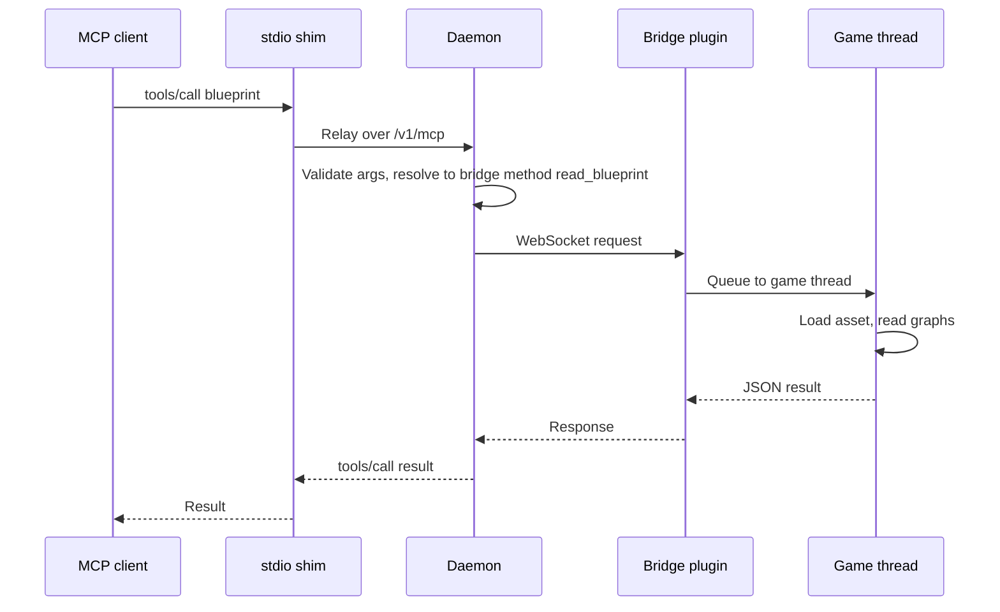

# Architecture

UE-MCP has three parts:

- **The daemon**: one background Node.js process per project. It runs the MCP server, owns the WebSocket connection to the editor, and serves an HTTP API on `127.0.0.1`.
- **The stdio relay (shim)**: what an MCP client launches as `ue-mcp <project.uproject>`. It finds or starts the project's daemon and relays MCP messages to it.
- **The bridge plugin** (`UE_MCP_Bridge`): C++ inside the Unreal Editor. It runs a WebSocket server and executes each request on the game thread.



## Server modes

`ue-mcp <project.uproject>` runs in one of two modes (`src/daemon/server-mode.ts`):

| Mode | What runs |
|------|-----------|
| `daemon` (default) | The process the client launched is a stdio shim. The daemon holds the editor connection. |
| `in-process` | The whole server runs inside the process the client launched, talking MCP over stdio. |

`UE_MCP_SERVER_MODE` wins, then `server.mode` in `ue-mcp.yml`, then the default. A daemon serves one project, so a launch with several projects or none always runs in process. If the daemon cannot be started, the shim falls back to in process and logs why.

## The daemon

**Source:** `src/daemon/`. **Started by:** the shim, `ue-mcp daemon start`, or `ue-mcp daemon run` (foreground).

The daemon holds one `Runtime` (`src/server/runtime.ts`): the editor sessions with their bridges, guards, dialog watcher and flow tool. Every MCP connection gets its own `McpServer` (`src/server/mcp-server.ts`) over that shared runtime, so several clients use one bridge per editor. An editor restart, crash or rebuild does not drop the clients.

**Discovery.** The daemon publishes `~/.ue-mcp/daemons/<key>.json`, where `<key>` is the first 16 hex characters of the SHA-1 of the normalized project root. The file is readable only by the user and holds the pid, port, bearer token, ue-mcp version, `apiVersion` and project root. The daemon log is `<key>.log` beside it. `UE_MCP_DAEMON_DIR` moves the directory.

**The shim** (`src/daemon/shim.ts`) reads the discovery file. If no live daemon of a usable version answers, it starts one detached, under a start lock so concurrent launches start one daemon. It then opens `ws://127.0.0.1:<port>/v1/mcp` with the token. If the daemon goes away, the shim answers each request in flight with an error (code `-32001`, outcome unknown), reconnects, and replays the client's `initialize` itself.

**Versions.** When the project has a binary bridge newer than the shim's package, the shim runs that release's daemon through `npx ue-mcp@<version>`. A newer daemon starting for a project asks the older one to hand off (`POST /v1/handoff`), and the older one exits once no call is in flight.

**Lifetime.** The daemon exits after 30 minutes with no client, event stream, connected editor or busy extension (`UE_MCP_DAEMON_IDLE_MS`), on `POST /v1/shutdown`, or on `ue-mcp daemon stop`.

### HTTP API

Every route is on `127.0.0.1` and needs `Authorization: Bearer <token>`. The served UI authenticates by a cookie set from `/ui?token=`, and `/v1/events` also accepts `?token=`. A request with a foreign `Origin` is refused.

| Route | Purpose |
|-------|---------|
| `GET /v1/health` | Version, `apiVersion`, editors, clients, calls in flight, extensions, UI bundle, `features` |
| `GET /v1/events` | Server-sent events, resumable by `Last-Event-ID` |
| `WS /v1/mcp` | One MCP session per socket |
| `GET /v1/install`, `GET /v1/update`, `POST /v1/update/apply` | Install state and updates |
| `POST /v1/editor/{start,stop,restart,rebuild}` | Editor operations, announced on the event stream |
| `/v1/checkpoints` | Checkpoints per editor session (`checkpoint-routes.ts`, see [Checkpoints](checkpoints.md)) |
| `/v1/plugins` | List, browse, install, update and uninstall ue-mcp plugins (`plugin-routes.ts`) |
| `/v1/flows` | List flows, `GET /v1/flows/<name>/plan`, `POST /v1/flows/<name>/run`, `GET /v1/flows/events` |
| `GET /v1/skills`, `GET /v1/actions`, `GET /v1/context/projection` | Skills, action effects, and what a context strategy advertises |
| `/v1/ext/<name>/` | Routes an extension registers |
| `GET /ui/` | The installed UI bundle |
| `POST /v1/shutdown`, `POST /v1/handoff` | Exit now, or once no call is in flight |

`DAEMON_API_VERSION` versions the HTTP API, the events and the shim protocol. `/v1/health` lists additions under `features`. [Configuration: the daemon](configuration.md#the-daemon) covers the CLI and what a client can read.

### Extensions and UI bundles

An extension (`src/daemon/extensions.ts`) is a package with `activate(api)` and a `ueMcpExtension` field naming the extension API range it supports. The daemon loads extensions at startup from `~/.ue-mcp/extensions/` (`UE_MCP_EXTENSIONS_DIR`). An extension can register routes under `/v1/ext/<name>/`, publish and read events, run actions in process with `callAction`, register a model provider, use checkpoints, keep a data directory, and trust a key for UI bundles. `EXTENSION_API_VERSION` versions this contract; the daemon serves every version from `EXTENSION_API_MIN_VERSION` up.

Versions install side by side as `<name>@<version>/`, and each project records the version it loads (`extension-versions.ts`), so updating an extension for one project does not change another. `ue-mcp extension install|use|list|remove` manages them.

A UI bundle (`src/daemon/ui-bundles.ts`) lives under `~/.ue-mcp/ui/`. It is served at `/ui/` only when its `manifest.sig` Ed25519 signature verifies against a key an extension trusted and every file matches its SHA-256 in `manifest.json`. A bundle named for a loaded extension is served only at that extension's version or older.

The `ue-mcp/daemon` package export (`src/daemon-api.ts`) carries the types and helpers for building on the daemon: discovery, the extension contract, events, and bundle signing.

### Where Studio attaches

[UE-MCP Studio](studio.md) is a daemon extension plus the `UE_MCP_Studio` editor plugin. The editor plugin starts the project's daemon. The daemon loads the Studio extension and serves its UI, which the Studio window shows. Studio reaches ue-mcp only through the daemon's HTTP API and the extension API.

## MCP server (TypeScript)

**Entry point:** `src/index.ts`. A first argument naming a command runs the CLI (`src/cli/`); otherwise it starts the shim or the in-process server.

The server registers the <!-- count:tools -->30<!-- /count --> category tools and the `flow` tool, each dispatched through the runtime's sessions.

### Key modules

| Module (under `src/`) | Purpose |
|--------|---------|
| `index.ts` | Entry: CLI routing, server mode, shim or in-process server |
| `daemon/` | Daemon, stdio shim, discovery, extensions, UI bundles, HTTP routes |
| `daemon-api.ts` | The public `ue-mcp/daemon` export |
| `server/runtime.ts` | Sessions, bridges, flow tool and dispatch, shared by every client |
| `server/mcp-server.ts` | One `McpServer` over a runtime: instructions, tools, flow |
| `tools.ts` | The `ALL_TOOLS` registry |
| `tools/` | One file per category |
| `bridge/bridge.ts` | `EditorBridge`: WebSocket client, request correlation, reconnect, capability handshake |
| `sessions/` | Registry of editors and each session's surface |
| `dispatch/` | Per-call routing, editor gate, locks, offline and Python gates |
| `config/project.ts` | `ProjectContext`: paths, `.uproject`, plugin mounts, `ue-mcp.yml` |
| `codeintel/` | INI reading, C++ parsing, engine symbol index, Content index |
| `core/types.ts` | `ToolDef`, `ActionSpec` and other shared types |
| `core/errors.ts` | `McpError` and the `ErrorCode` enum |
| `surface/category-tool.ts` | `categoryTool()`, `bp()`, routing parameter schemas |
| `surface/target-params.ts` | The per-call `editor` / `toEditor` parameters |
| `surface/schemas.ts` | Zod schemas for `.uproject`, `.uplugin` and `ue-mcp.yml` |
| `surface/action-signature.ts` | One-line action signatures and their legend |
| `surface/context/instructions.ts` | Server instructions, one variant per context strategy |
| `surface/context/lean-context.ts` | Strategy choice, the lean `catalog`, paged `describe`, signature `search` |
| `surface/context/micro-context.ts` | The micro `tools` gateway |
| `surface/context/call-envelope.ts` | The `action` + `args` call shape and its validation |
| `editor/deployer.ts` | Plugin deployment and `.uproject` edits |
| `editor/editor-control.ts`, `editor/editor-build.ts` | Start and stop the editor; build the project |
| `checkpoints/` | Checkpoint history in a shadow git repository |
| `feedback/` | Feedback routing and filing, GitHub OAuth device flow (`~/.ue-mcp/auth.json`) and GitHub App fallback |
| `flow/` | Flow engine and its HTTP surface, see [Flows](flows.md) |
| `cli/` | CLI commands (`ue-mcp --help` lists them) |

### Defining a category

Every category is built with `categoryTool(name, summary, actions, extraSchema?, options?)`:

```typescript
export const demoTool: ToolDef = categoryTool(
  "demo",
  "Neon Shrine demo scene builder and cleanup.",
  {
    step:      specBp("mutate", "Execute demo step.", "demo_step"),       // bridge action
    get_steps: specBp("read", "List every demo step.", "demo_get_steps"),
  },
  { ...specSchema },   // parameters generated from the C++ specs
);
```

Two kinds of action:

- **Bridge actions** are forwarded to the plugin. `specBp(effect, summary, method)` declares one whose parameters come from the handler's [parameter spec](#parameter-specs).
- **Local actions** (`{ kind: "handler", effect, description, handler }`) run in Node.js, for example INI parsing, C++ source reading and editor start and stop.

### Advertised surface and context strategy

The [context strategy](configuration.md#context-strategy-full-lean-micro) decides what a client is handed at startup. `micro`, the default, advertises one `tools` gateway (<!-- tax:micro -->~2.2k<!-- /tax --> tokens with the instructions). `lean` advertises the category tools with a summary each (<!-- tax:lean -->~20k<!-- /tax -->). `full` adds one signature line per action (<!-- tax:full -->~55k<!-- /tax -->). `scripts/context-tax.mjs` measures these and a release gate holds each to its budget.

A category tool is advertised as `action` (the enum of its actions) plus `args` (an object). The server unwraps `args` and validates it against the category's zod shape, so a refusal names the bad parameter. The micro gateway's `call` is checked against the target category the same way.

Action signatures (`set_property(assetPath|path, propertyName, value:*, save?:b)`) are generated from a spec'd action's recorded C++ spec, an `epic_*` action's input schema, or otherwise the declared shape `describe_action` reports. The notation is explained once, in the instructions.

### Bridge communication

The `EditorBridge` connects to the bridge's per-project port. The port is derived from a hash of the project root and published to `<project>/Saved/UE_MCP_Bridge/port.json`, which is authoritative (see [Configuration](configuration.md#bridge-connection)). The fixed `9877` is used only when no project root is known.

Editor lifecycle actions (`start_editor`, `stop_editor`, `restart_editor`) act on a process, so they resolve the editor from the project's lockfile alone, refuse when it is absent, and scope every process check to the `.uproject` on the command line. See [Which editor lifecycle actions act on](configuration.md#which-editor-lifecycle-actions-act-on).

**Wire format.** Each request is one JSON text frame; responses carry `"jsonrpc": "2.0"` and the request `id`.

```json
// Request
{ "id": "req-42", "method": "get_outliner", "params": { "classFilter": "StaticMeshActor" } }

// Response
{ "jsonrpc": "2.0", "id": "req-42", "result": { "actors": [] } }
```

- **Timeout:** 30 seconds by default. A handler registered with a longer timeout gets that plus 5 seconds, and a caller's `timeoutMs` is honoured, up to one hour. The plugin waits at least the caller's budget on the game thread.
- **Reconnect:** every 15 seconds while disconnected.
- **Correlation:** responses are matched to requests by `id`.

#### Framing

Both ends treat a TCP read as bytes, not a message. They decode every whole WebSocket frame that has arrived and join continuation frames into one message, so pipelined requests in one segment all arrive and a payload split across segments is reassembled.

A message, the unparsed receive buffer and any single frame's declared length are each bounded at 64 MiB. Exceeding one closes the connection with status `1009` and a reason naming the size and the limit, which the client repeats verbatim. A frame stream that stops parsing (reserved bits set, an unknown opcode, a fragmented control frame, or an unmasked client frame) closes with `1002`.

A close frame gets its status code echoed back and a ping gets a pong with the same payload. When the editor shuts down with a client attached, the bridge closes with `1001`.

The upgrade request is read to its blank line under one deadline and one size bound, and validated before a `101` is sent: `GET`, HTTP/1.1, `Upgrade: websocket`, `Connection: Upgrade`, `Sec-WebSocket-Version: 13`, and a `Sec-WebSocket-Key` that decodes to 16 bytes. A refusal answers with an HTTP status and a sentence. Bytes pipelined behind the request go straight to the frame reader.

#### Capability handshake

On connect the client calls `get_bridge_capabilities`, which the bridge answers on the socket thread without touching the game thread:

| Field | Meaning |
|-------|---------|
| `protocolVersion` | Wire protocol the plugin speaks (`UEMCP_BRIDGE_PROTOCOL_VERSION`) |
| `handlerApiVersion` | Handler ABI for native plugins (`UEMCP_BRIDGE_API_VERSION`) |
| `builtAt` | Compile timestamp of the loaded binary |
| `engineVersion`, `projectName`, `pid`, `port`, `instanceId`, `startedAt` | Which editor answered |
| `features` | Named capabilities |
| `actions`, `actionCount` | The method names the running binary registered |
| `handlerSpecs` | The declared parameter contract of every spec'd handler (see [Parameter specs](#parameter-specs)) |

A plugin without the handshake answers `Unknown method`, which the client records as protocol version 1. When plugin and client versions differ, the client says so at connect, repeats it on any unknown-method answer, and reports it under `bridgeProtocol` in `project(get_status)`.

`bridgeApiVersion` in `project(get_status)` is read from the header on disk and describes the source; `bridgeProtocol` comes from the running binary. When they disagree, the deployed plugin has not been rebuilt.

#### Parameter specs

A handler declares its parameters once, in C++, at registration:

```cpp
Registry.RegisterHandler(TEXT("set_montage_slot"), &SetMontageSlot, {
	MCPParam::Required(TEXT("assetPath"), EMCPParamType::String, TEXT("AnimMontage asset path")).Alias(TEXT("path")),
	MCPParam::Required(TEXT("slotName"), EMCPParamType::String, TEXT("Slot name to write onto the track")),
	MCPParam::Optional(TEXT("trackIndex"), EMCPParamType::Integer, TEXT("Slot track index (default 0)")),
});
```

The contract travels one way:

1. **The registry** validates the spec at registration. It refuses the routing names (`action`, `timeoutMs`, `select`, `omit`, `editor`, `toEditor`), a name declared twice, an item type on anything but an array, a value shape that does not fit its type, and a choice naming an undeclared or required parameter. A refused spec is logged and dropped; the handler still registers. At dispatch it renames each alias to its parameter's name, so the handler reads declared names only.
2. **The bridge** publishes every spec in `get_bridge_capabilities.handlerSpecs`.
3. **`npm run specs:record`** writes that answer from a `tests/ue_mcp` editor to `tests/golden/handler-specs.json`.
4. **`npm run specs:generate`** renders the recording into `src/tools/specs/<category>.generated.ts`: one zod entry per name and alias, and each method's `Params:` clause.
5. **The category** declares the action with `specBp(effect, summary, method)`. Only the summary and effect are hand-written. A rename is an alias in the spec. `prepareCall` refuses a call that does not satisfy the spec's choices before anything is sent, on the MCP and flow routes alike.

The advertised surface always comes from the recording, so the startup contract does not depend on which plugin answered. With an editor connected, `project(get_status)` reports any difference from the recording under `deployedPlugin.handlerSpecDrift`.

Four tests hold the chain: `tests/unit/handler-specs.test.ts` (the generated modules match the recording, and every bridge action takes its parameters from a spec), `tests/live/handler-specs.test.ts` (the running plugin publishes what was recorded), the C++ test `UE.MCP.Bridge.HandlerSpec.Contract` (each spec'd handler, called with every declared parameter, reads exactly those), and `tests/unit/handler-spec-exempt.test.ts` (a contract-exempt handler's source reads exactly what its spec declares).

##### What a spec can say

Beyond a list of named, typed parameters:

- **A required choice.** `MCPSpec::ExactlyOne({ { TEXT("settings") }, { TEXT("propertyName"), TEXT("propertyValue") } })` means one branch and never two; `MCPSpec::AtLeastOne(...)` means one or more. Each branch is a set of names that go together, and every name in a choice is a declared optional parameter. `describe_action` reports it as a choice group, and a call that satisfies none, both sides of an exactly-one choice, or half a branch is refused with the choice spelled out. The contract test calls such a handler once per branch.
- **A value shape.** `EMCPParamType::Color` is `{r, g, b, a?}`. `.Or(EMCPParamType::Color)` makes a union, `.Nullable()` makes null a value of its own, `.Literal(false)` accepts one value, and `.WithFields({ MCPParam::RequiredField(...), ... })` declares an object's fields, or those of each element of an array of objects.
- **A tagged union.** `.Tagged(TEXT("op"), { MCPParam::Variant(TEXT("set"), TEXT("..."), { fields }), ... })` says field `op` holds a tag and each tag has its own fields. It generates a zod `discriminatedUnion` of strict objects, so a field from another variant is refused. The signature writes it `o<op>` (`[o<op>]` for an array). Rules between fields are enforced by the handler, not the spec.
- **Value forms.** `.OneOfForms({ EMCPValueForm::ArgMap, EMCPValueForm::StringList, EMCPValueForm::ArgEntryList, EMCPValueForm::String })` on an `Any` value lists the shapes it takes, each with a fixed schema; a value that fits none is refused with every form named. The handler reads it through `MCPReadFunctionArgs` (to a name-to-value map for a UFUNCTION) or `MCPReadPythonArgs` (to positional arguments), both in `HandlerFunctionCall.h`.
- **A contract exemption.** `MCPSpec::ContractExempt(TEXT("why"))` marks a handler whose contract values would reach a create, spawn, save or run. The contract test does not call it; the source check holds it to its spec instead, and a read whose key is not a literal fails that check.

A choice or an exemption is the last argument: `RegisterHandler(name, fn, { ... }, MCPSpec::ExactlyOne(...).ContractExempt(...))`, or `RegisterHandlerWithTimeout(name, fn, seconds, { ... }, rules)`. The recording includes each addition (`choices`, `contractExempt`, and on a parameter `nullable`, `orTypes`, `literal`, `fields`, `forms`, `oneOf`) only when it is used.

The `epic_*` actions are the one passthrough: each dispatches to `epic_call_tool`, whose spec declares the bag it takes (`toolset`, `tool`, `input`, `inputJson`), and a mapper builds that bag from the wrapped tool's recorded input schema.

#### Socket and thread ownership

The accept loop hands each client socket to one connection thread, which owns it and closes it exactly once. No other code closes a client socket.

The accept loop counts a connection before its thread exists, and the thread releases the count on exit, so shutdown waits for zero before freeing the server. Connections see the stop flag at the end of their current one-second select. If that grace period lapses, shutdown half-closes their sockets, then after a further wait logs which connections are stuck. The game-thread executor abandons in-flight waits once shutdown begins, because module teardown runs on the game thread.

## C++ bridge plugin

**Location:** `plugin/ue_mcp_bridge/`

The plugin runs a raw WebSocket server on a dedicated thread, dispatches each request to its registered handler, and executes it on the game thread.

### Modules

| Module | Type, loading phase | Role |
|--------|---------------------|------|
| `UE_MCP_BridgeStatus` | Editor, `PostConfigInit` | Writes what the engine is doing (phase, slow task and percent, modal dialog, compile counts, game-thread stall) to `Saved/UE_MCP_Bridge/status.json` from a writer thread. Core-only dependencies, so it loads early enough to cover RHI init, module loading, map load and Python startup. |
| `UE_MCP_BridgeRuntime` | DeveloperTool, `Default` | PIE input injection, remote control and viewport capture. |
| `UE_MCP_Bridge` | Editor, `PostEngineInit` | The WebSocket server, the handler registry, and the Slate- and engine-backed sensors it adds to the status snapshot. |

### Core classes and headers

| Name | Purpose |
|-------|---------|
| `FMCPBridgeServer` | WebSocket server on raw platform sockets |
| `FMCPHandlerRegistry` | Maps method names to handlers and their specs |
| `FMCPGameThreadExecutor` | Queues work to the game thread |
| `HandlerUtils.h` | Umbrella over the shared helper headers, and the one include external plugins rely on |
| `HandlerResult.h` | `MCPError`, `MCPSuccess`, `MCPResult`, `MCPErrorWithCode`, `MCPSetCreated`/`Existed`/`Updated`, `MCPSetRollback`/`MCPSetNoRollback` |
| `HandlerParams.h` | `RequireString`, `OptionalString`, `OptionalVec3`, `OptionalRotator` and the other readers, with parameter read tracking |
| `HandlerAssetResolve.h` | `MCPLoadAssetObject`, `MCPAssetNotFoundError`, `LoadAssetByPath<T>`, `REQUIRE_ASSET`, `LoadBlueprintCDO<T>`, the protected-mount rule |
| `HandlerActorResolve.h` | `MCPResolveActor` and its selector, ambiguity refusals, `MCPCheckActorLabelExists` |
| `HandlerClassResolve.h` | `MCPResolveClass`, `MCPResolveClassOfType`, `MCPResolveScriptStruct` |
| `HandlerWorld.h` | `GetEditorWorld`, PIE world lookups, `ResolveWorldFromParams`, `REQUIRE_EDITOR_WORLD` |
| `HandlerPackageSave.h` | `SaveAssetPackage`, `SaveAssetPackageChecked`, `MCPPackageWriteBlocked`, `MCPNoteSaveOutcome` |
| `HandlerJsonConvert.h` | Vector, rotator, colour, quaternion, transform and string-list JSON builders |
| `HandlerObjectUtils.h` | Property export, file dumps, `FGCRootScope`, subobject walks, component and collision lookup |
| `HandlerEngineVersion.h` | The `UE_MCP_HAS_5_x_API` gates and engine API shims |
| `HandlerAssetCreate.h` | `MCPCreateAssetIdempotent<T>` |

### Handler groups

`HandlerCatalog.cpp` registers 42 handler groups. Each lives in `Private/Handlers/<Category>/`.

| Handler group | Coverage |
|---------|----------|
| EditorHandlers | Console, Python, PIE start and stop, viewport, build, logs, perf, screenshots, scalability |
| AssetHandlers | CRUD, import, search, DataTables, textures, sockets |
| AssetGeometryHandlers | Geometry Script mesh authoring and fracture |
| AssetMeshBooleanHandlers | Boolean mesh operations |
| AssetMeshBuildHandlers | Static mesh build settings |
| AssetBulkReadHandlers | Property reads across many assets in one call |
| BlueprintHandlers | Read and write, graphs, compilation, node types, T3D, reparent, validate |
| CollisionQueryHandlers | World traces, overlaps and sweeps |
| LevelHandlers | Actors, components, volumes, lights, world settings |
| ReflectionHandlers | Class, struct and enum reflection, gameplay tags |
| GasHandlers | Gameplay Ability System |
| GameplayHandlers | Physics, collision, navigation, AI, input, game framework |
| DialogHandlers | Modal dialog policies and responses |
| MaterialHandlers | Materials, instances, expression graphs, render preview |
| AnimationHandlers | Anim blueprints, montages, blendspaces, skeletons, IK Rig, Control Rig |
| AudioHandlers | Playback, ambient sounds, SoundCues, MetaSounds |
| WidgetHandlers | UMG widget trees, editor utility widgets |
| FoliageHandlers | Foliage types and instances |
| LandscapeHandlers | Landscape proxies, layers, materials |
| NetworkingHandlers | Replication, dormancy, relevancy, net priority |
| NiagaraHandlers | Systems, emitters, renderers, data interfaces |
| PCGHandlers | PCG graphs |
| SequencerHandlers | Level sequences and tracks |
| SplineHandlers | Spline authoring |
| PhysicsHandlers | Collision profiles, simulation, body properties |
| DemoHandlers | Neon Shrine demo builder |
| ProjectHandlers | Project info, world subsystem queries |
| StateTreeHandlers | StateTree authoring |
| ChooserHandlers | Chooser tables |
| EpicHandlers | The UE 5.8 Toolset Registry |
| MassHandlers | Mass Entity fragments, traits and processors |
| SkeletalMeshHandlers | Skeletal mesh LODs, sections, instancing settings |
| FabHandlers | Fab library import |
| DatasmithHandlers | Datasmith scene import and query |
| MetaHumanHandlers | MetaHuman characters |
| LockHandlers | Per-asset locks for concurrent agents |
| DiffHandlers | Semantic Blueprint and asset diffing |
| CheckpointHandlers | Checkpoint arming and restore |
| SourceControlHandlers | Source control through the editor's provider |
| PIEHandlers | PIE recording, replay, observation, input and test scripts |

### Dependencies

`UE_MCP_Bridge.Build.cs` links a wide set of engine and plugin modules, among them Core, CoreUObject, Engine, Json, UnrealEd, AssetRegistry, BlueprintGraph, Kismet, UMG, Landscape, Niagara, PCG, Sequencer, GameplayAbilities, NavigationSystem, AIModule, StateTreeModule, ControlRig, IKRig, MetasoundEngine, PythonScriptPlugin, EditorScriptingUtilities and DataValidation. LiveCoding is linked on Windows only. Optional modules such as Water are loaded at runtime with `LoadClass<>()` rather than linked.

## What works without the editor

Every tool is advertised whether or not an editor is attached. Bridge actions need a running editor; local actions run in Node.js. `src/dispatch/offline.ts` lists which local actions work with the editor down.

| Works without an editor | Needs the editor |
|-------------------------|------------------|
| `project(get_status)`, config INI reading and search | Blueprint, material, level and asset authoring |
| C++ source and header reading and writing, engine symbol index | Reading assets through the engine |
| Content folder listing | PIE |
| `project(build)`, `editor(start_editor)` and `stop_editor` | Anything else that dispatches to the bridge |
| Checkpoint listing and restore, feedback | |

## Path resolution

`ProjectContext` resolves content paths to files:

| Input | Resolved to |
|-------|-------------|
| `/Game/MyAsset` | `<ProjectDir>/Content/MyAsset.uasset` |
| `/MyPlugin/Foo` | `Content/Foo` under that plugin's directory, project or engine |
| Absolute path | Used as-is |
| Relative path | Relative to `<ProjectDir>/Content` |

## Data flow example

A client calls `blueprint(action="read", args={assetPath: "/Game/BP_Player"})` in daemon mode:


