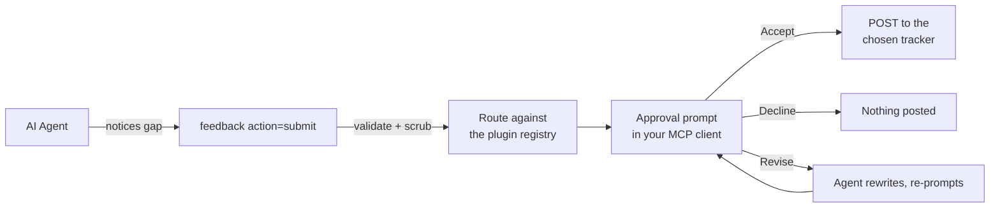

# Feedback

`feedback(submit)` files a GitHub issue describing a tool gap, so maintainers can close it with a native handler. It files against the tracker that owns the surface: ue-mcp core, or the plugin that provides it, found through the [plugin registry](https://plugins.ue-mcp.com). Nothing posts without your approval, and the body is scrubbed for credentials and personal identifiers on your machine first.

## How it works



1. The agent calls `feedback(action="submit")` with `title` and `summary`, and optionally `pythonWorkaround` and `idealTool`.
2. The server validates it: it rejects placeholder titles, meta or apology submissions, short titles and summaries, and a summary that only repeats the title.
3. The server picks the tracker ([Routing](#routing-to-the-right-tracker)).
4. The server builds the body and runs the credential and privacy scrubs ([What gets scrubbed](#what-gets-scrubbed)).
5. The server sends an MCP elicitation: your client shows the body, the destination tracker, an optional revisions field, and Accept and Decline.
6. Depending on your answer, the server posts, returns your revisions to the agent, or discards the report.

If the prompt cannot reach a person, the report is saved to disk instead ([When the approval form never reaches you](#when-the-approval-form-never-reaches-you)).

## Routing to the right tracker

Each ue-mcp plugin has its own repository and tracker. The server reads the registry catalog from `https://plugins.ue-mcp.com/api/plugins` (cached for 15 minutes in memory and on disk at `~/.ue-mcp/registry-catalog.json`) and combines it with the plugins loaded in your project. Precedence, strongest first:

| Signal | Example | Result |
|---|---|---|
| `repo` parameter | `repo="db-lyon/ue-mcp-perforce"` | Honored only for ue-mcp core or a repo a registered plugin owns. Anything else files against core. |
| Ownership | `idealTool="recorder(action=replay)"` and a loaded plugin provides the `recorder` category | That plugin's repo, confidence `certain`. |
| Core anchor | The text names a built-in action such as `editor(play_in_editor)` | Core, even when a plugin also matched. The match is shown at the prompt. |
| Identity terms | The title names the plugin's slug, name, or a category it provides | That plugin's repo, confidence `likely`. |
| Tag terms only | A listing's descriptive tag (`import`, `replay`) appears in the text | Core. The match is offered at the prompt as an override. |

A plugin with no public repo is never the destination; the report goes to core with a note naming the owner.

Preview the decision without posting:

```text
feedback(action="route",
  title="recorder(replay) diverges from the recorded run after 200 frames",
  summary="Replaying a recorded session drifts from the capture by several metres.")
```

It returns the target repo, the matched plugin and why, runner-up suggestions, the core anchor, and whether the registry was reachable.

A posted issue carries a `## Routing` section with what matched and on what evidence. It reads the same whichever tracker you pick, so switching the tracker at the prompt does not change the body you approved.

An unreachable registry with no cached copy routes to core. To route every report to core and skip the lookup:

```bash
UE_MCP_FEEDBACK_ROUTING=off npx ue-mcp ./MyGame.uproject
```

A report filed on a plugin repo carries only `agent-feedback` and a type label (`bug` or `enhancement`). Core category labels stay on core.

If the chosen tracker refuses the issue (issues disabled, or your account cannot open one there), nothing is posted. The result carries a prefilled `https://github.com/<owner>/<repo>/issues/new?...` URL and the option to re-run against core. In `auto-approve` mode the report falls back to core and the result says so.

## Feedback modes

| Mode | What `feedback(submit)` does |
|---|---|
| `interactive` (default) | Scrubs, then asks on the elicitation prompt. Nothing posts without your approval. |
| `auto-approve` | Scrubs, then posts with no prompt. For unattended runs where you trust the agent's reports. |
| `defer` | Scrubs, then writes the report to `~/.ue-mcp/pending-feedback/<id>.json` with no prompt and no network call. Review the queue later with `npx ue-mcp feedback`. |

The mode is a per-user setting kept in `~/.ue-mcp/state.json`, optionally scoped to one project. It is not read from `ue-mcp.yml`, and the agent has no way to change it.

```bash
npx ue-mcp feedback mode                    # the effective mode and where it came from
npx ue-mcp feedback mode defer              # set the per-user mode
npx ue-mcp feedback mode defer --editor MyGame   # set it for one project
npx ue-mcp feedback mode default            # clear it
```

`npx ue-mcp init --feedback-mode <mode>` sets the project's mode, and a daemon extension can set it too. For one run, set `UE_MCP_FEEDBACK_MODE`, which is not written to disk:

```bash
UE_MCP_FEEDBACK_MODE=defer npx ue-mcp ./MyGame.uproject
```

Precedence: `UE_MCP_FEEDBACK_MODE`, then the project's mode, then the per-user mode, then `interactive`.

Both `auto-approve` and `defer` skip the approval prompt. The scrubs still run. Use `defer` for unattended runs where you want to read each report before it leaves the machine.

### Reviewing deferred submissions

```bash
npx ue-mcp feedback review           # walk the queue: approve, discard, skip or quit per entry (experimental)
npx ue-mcp feedback list             # pending entries
npx ue-mcp feedback show <id>        # full title, body, labels and tracker
npx ue-mcp feedback approve <id>     # post, then delete
npx ue-mcp feedback discard <id>     # delete without posting
```

`review` stops with the entry left on disk when a post needs authorization or the network fails. Approved entries post with the `author` and tracker recorded at submit time. The queue is `~/.ue-mcp/pending-feedback/` (`UE_MCP_PENDING_DIR` overrides it).

## The approval prompt

The prompt shows:

- The exact body that would post, already scrubbed.
- The destination tracker, and a `ROUTING` block when a plugin matched.
- Who the issue will be authored as: your GitHub account or the `ue-mcp-feedback` bot.
- A `Submit with revisions (optional)` text field.
- A `Tracker` field, when there is a second tracker worth offering. It accepts only the two repos it names.
- Your client's Accept and Decline buttons.

| Click | Revisions field | Result |
|---|---|---|
| Accept | empty | Posts to the tracker in the `Tracker` field. |
| Accept | filled in | Your notes go back to the agent, which rewrites and asks again. Nothing posts until you approve. |
| Decline | any | Discarded. The agent is told you declined. |

The approval comes from your client's UI over the protocol, so the agent cannot forge it.

## When the approval form never reaches you

The fallback applies when the client did not advertise `elicitation`, threw on the request, or answered faster than a person could (`UE_MCP_ELICIT_MIN_HUMAN_MS`, default 1000). Some clients decline automatically before rendering anything. Nothing posts and nothing is lost:

1. The scrubbed report is saved to `~/.ue-mcp/pending-feedback/<id>.json`, with a readable `<id>.md` beside it.
2. The result offers three ways to file it:
    - A prefilled `https://github.com/<owner>/<repo>/issues/new?title=...&body=...` URL. The URL is capped by its encoded length; when the body does not fit, the link carries the longest prefix that does and names the file holding the rest, and when not even the title fits there is no link.
    - `npx ue-mcp feedback approve <id>`.
    - A confirmation token at the top of `<id>.md`. Read it to the agent and it calls `feedback(submit)` with `confirmToken`, which posts the saved bytes. The token never appears in the tool result. It confirms that a person agreed; an agent with file access could read it.

The approval prompt needs a client that advertises the `elicitation` capability (Claude Code 2.1.76 or later). Without it the result is a `feedback.fallback` directive with `code: "elicitation_unsupported"`.

## Authorship

- `author: "user"` (default): the issue is authored by your GitHub account, with a token cached by `npx ue-mcp auth`. Without one, the call returns an `auth_required` directive.
- `author: "bot"`: the issue is authored by `ue-mcp-feedback[bot]`.

The package holds no GitHub credential. Bot reports are posted to a hosted signing service, `https://feedback.ue-mcp.com`, which holds the App key, accepts only ue-mcp core and the trackers of published plugins, rate-limits per caller, and opens the issue. When the service is unreachable, or answers that it has no signing key (`signing_not_configured`), the call returns a prefilled issue URL instead. `author="user"` does not depend on the service.

| Variable | Effect |
| --- | --- |
| `UE_MCP_FEEDBACK` | Origin of the signing service, posted to at the root. Default `https://feedback.ue-mcp.com`. |
| `UE_MCP_FEEDBACK_ENDPOINT` | The full URL. The only one tried. |
| `UE_MCP_REGISTRY` | Set without `UE_MCP_FEEDBACK`, that origin's `/api/feedback` is tried first. |

With neither feedback variable set, the client tries `https://feedback.ue-mcp.com`, then `https://plugins.ue-mcp.com/api/feedback` only when the first does not answer at all (DNS, TLS, timeout, or a gateway page). Any answer from the service is final, so a report is never filed twice.

### Authorizing as your GitHub user

```bash
npx ue-mcp auth
```

Runs the GitHub device flow for the `ue-mcp-feedback` GitHub App: open the URL, enter the code, authorize. The token is cached at `~/.ue-mcp/auth.json` (mode 600, or in `UE_MCP_AUTH_DIR`). The command exits non-zero when authorization is denied, expires or fails. `--json` prints the code and the outcome as JSON lines.

`UE_MCP_GITHUB_OAUTH` (default `https://github.com`) and `UE_MCP_GITHUB_API` (default `https://api.github.com`) point the device flow and the issue posts at another origin, such as GitHub Enterprise.

`npx ue-mcp init` offers this step when you turn on the feedback prompt hook.

## What gets scrubbed

Two passes run on the title and body before the approval prompt or any post. The agent cannot skip them or see the unscrubbed text.

### Credential scrub

These are replaced with `[REDACTED]`:

- GitHub tokens (`ghp_`, `gho_`, `ghu_`, `ghs_`, `ghr_`, `github_pat_`)
- AWS access key IDs (`AKIA`, `ASIA`)
- Slack tokens (`xoxb-`, `xoxp-` and similar)
- Stripe secret keys (`sk_live_`, `sk_test_`)
- Anthropic API keys (`sk-ant-`)
- OpenAI keys (`sk-`)
- JSON Web Tokens
- PEM private key blocks
- Assignments whose key names a secret (`PASSWORD=`, `TOKEN=`, `API_KEY=` and similar); the key is kept, the value redacted

Shapes not on this list pass through. Read the body before you accept.

### Privacy scrub

| What | Replacement |
|---|---|
| Project root path, and those of other projects the server drives | `REDACTED_PROJECT_ROOT` |
| Home directory path | `REDACTED_HOME` |
| Project name, and those of other projects the server drives (whole word, case-insensitive) | `REDACTED_PROJECT` |
| OS username (whole word, case-insensitive) | `REDACTED_USER` |

Paths match with either slash direction. Class, component and actor names are not redacted, since the report usually needs them. Ask for more redactions in the revisions field.

## Submit parameters

| Parameter | Required | Description |
|---|---|---|
| `title` | Yes | The specific gap. At least 10 characters, not a placeholder. |
| `summary` | Yes | What was attempted and why the native tool fell short. At least 40 characters, and more than the title. |
| `pythonWorkaround` | No | The `execute_python` code used as a workaround. Optional: a crash or a missing action is a valid report. |
| `idealTool` | No | The tool or action that should handle this, such as `blueprint(action='set_variable_default')`. Also the strongest routing signal. |
| `author` | No | `"user"` (default) or `"bot"`. See [Authorship](#authorship). |
| `repo` | No | `owner/name` tracker override. Routing normally picks it. |
| `confirmToken` | No | The token from a saved report. See [When the approval form never reaches you](#when-the-approval-form-never-reaches-you). |

`feedback(action="route")` takes `title`, `summary`, `idealTool` and `repo`, and posts nothing.

## Example

The shape of a report. The gap named here is hypothetical.

```text
feedback(action="submit",
  title="No action to set a Niagara emitter's fixed bounds",
  summary="Tried to set fixed bounds on an emitter so it stops culling at the screen edge. No niagara action sets them, so the change was made with execute_python on the emitter's properties.",
  pythonWorkaround="import unreal; system = unreal.load_asset('/Game/FX/NS_Sparks'); ...",
  idealTool="niagara(action='set_emitter_bounds', assetPath, emitterName, min, max)"
)
```

## Claude Code prompt hook

`npx ue-mcp init` offers an opt-in Claude Code PostToolUse hook that runs after every `execute_python` call and tells the agent to describe the workaround and offer `feedback(submit)`. Without it, the agent files feedback only when you ask.

The hook lives in `<project>/.claude/settings.json`, and its path is recorded in `~/.ue-mcp/state.json` so a later `init` can find it. Remove installed hooks with:

```bash
npx ue-mcp uninstall-hooks
```

The hook does nothing when `feedback` is in `ue-mcp.disable` or the call's project is not a ue-mcp project.

## Turning feedback off

`feedback` is off unless enabled: the **Agent behavior** step of `npx ue-mcp init` (or `--feedback` / `--no-feedback`) turns it on or off, unchecked on a fresh install. Off means `feedback` is in `ue-mcp.disable` and the tool is not registered. The `execute_python` workaround directive and the server instructions then stop mentioning `feedback(submit)`, and the agent points you at https://github.com/db-lyon/ue-mcp/issues instead.

## For maintainers

Issues carry the `agent-feedback` label and these sections, all scrubbed:

- **Summary**
- **Ideal Tool/Action**, when supplied
- **Python Workaround Used**, when supplied
- **Session Workaround Log**: every `execute_python` call recorded in the session
- **Routing**: the plugin that matched and the evidence, when one did

`npx ue-mcp resolve <issue-number>` fetches an issue, creates a branch, has Claude Code implement the fix and opens a PR. See [Development](development.md#resolving-an-issue-with-claude-code).
