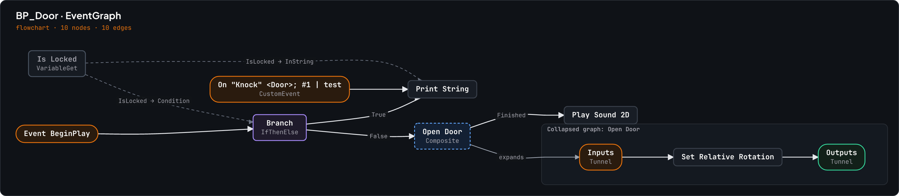
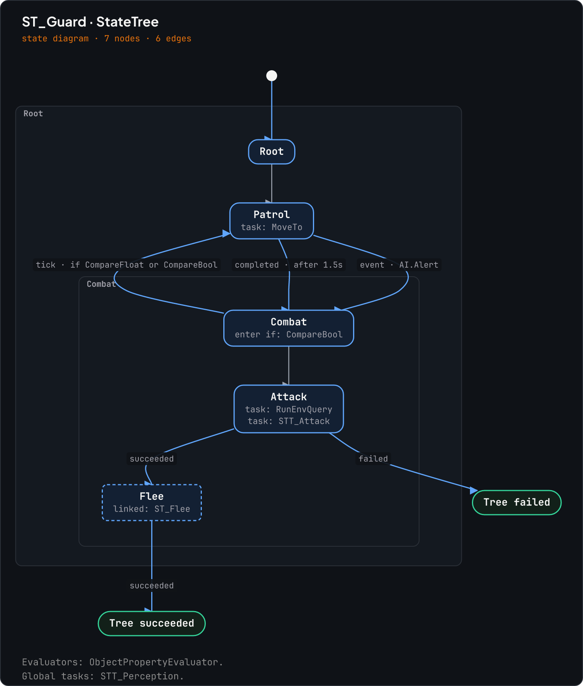
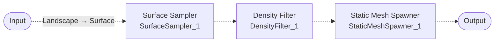

# Graph diagrams

Every category with a graph reader also has a `diagram` action. It reads the
graph through that reader and draws it: as Mermaid text you can paste into a
pull request, a wiki or these docs, or as an image ue-mcp draws itself.

| Category | Action | Reads | Drawn as |
|---|---|---|---|
| `blueprint` | `diagram` | `read_graph_summary` (plus each collapsed graph with `expandCollapsed`) | flowchart, exec wires solid, data wires dashed |
| `animation` | `diagram` | `read_state_machine` and each transition's rule graph, or the AnimGraph, or a Control Rig | state diagram, or flowchart |
| `statetree` | `diagram` | `read` | state diagram with nested states |
| `gameplay` | `diagram_behavior_tree` | `read_behavior_tree_graph` | top-down flowchart from ROOT |
| `material` | `diagram` | `read_graph`, every page | flowchart into the material output |
| `pcg` | `diagram` | `read_graph` | flowchart from the input node to the output node |
| `asset` | `diagram` | `read_graph` (any other EdGraph asset) | flowchart, one subgraph per graph |

The action is read-only: the editor sees an ordinary read, and the drawing
happens in the ue-mcp process.

## Formats

`format` picks the output.

- `mermaid` (the default): Mermaid text in the `mermaid` field. A flowchart for
  exec and data graphs, `stateDiagram-v2` for state machines and StateTree.
- `svg`: an image file, laid out with a layered layout and drawn in the ue-mcp
  look. The result gives its `path`, `width` and `height`.
- `png`: the same image rasterised. It comes back inline as image content, so a
  client that shows images shows the diagram in the conversation, and it is
  written to a file as well.
- `json`: the normalised `graph` (nodes, edges, groups) the other formats are
  drawn from.

Files go to `<Project>/Saved/UE_MCP/Diagrams/` unless `outputPath` names one.
PNG uses the optional `@resvg/resvg-js` package; where it is not installed the
action writes the SVG and says so in `pngUnavailable`.

## Large graphs

A drawing holds 80 nodes unless `maxNodes` says otherwise (up to 500). Nodes are
kept in order of distance from where the graph starts (its events, entry nodes
or initial state), and what is left out is named twice: a note node in the
drawing and a sentence in `notes`.

To draw a different part, pass `focus` with a node title, a node id or a state
name, and `depth`, the number of hops to follow from it in either direction
(default 3). Focusing a StateTree parent state draws all of its children.
On a Blueprint, `edges: "exec"` with `focus` on an event traces that event's
execution flow.

## Examples

A Blueprint event graph with its collapsed graph expanded beside it:

```json
{ "action": "diagram", "assetPath": "/Game/Blueprints/BP_Door", "expandCollapsed": true, "format": "png" }
```



A StateTree, its parent states drawn as boxes entered through their first child,
and each transition labelled with its trigger, event tag, conditions and delay:

```json
{ "action": "diagram", "assetPath": "/Game/AI/ST_Guard", "format": "png" }
```



A PCG graph as Mermaid:

```json
{ "action": "diagram", "assetPath": "/Game/PCG/PCG_Forest" }
```



## Mermaid details

- Node ids come from the reader's own ids (node GUIDs, PCG node names, StateTree
  state ids), so the same graph read twice gives the same text and two versions
  diff cleanly.
- Every label is quoted, and the characters Mermaid reads as syntax (`"`, `#`,
  `;`, `<`, `>`, `|`, `&`, backticks and braces) are written as entity codes.
- Collapsed graphs, extra function graphs, StateTree parent states and multiple
  asset graphs become subgraphs or composite states.
- Wires and transitions carry labels: the pin names a wire joins (default pins
  such as `then` and `ReturnValue` are left out), and a transition's rule, blend
  time, trigger, event or conditions.
- Each node role gets a class (`ue_entry`, `ue_branch`, `ue_state`, ...) styled
  with the ue-mcp colours.
