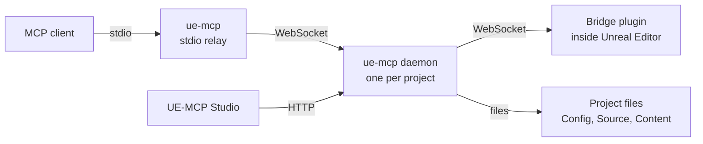

# UE-MCP

**Unreal Engine Model Context Protocol Server.** It lets AI assistants drive the Unreal Editor through <!-- count:tools -->30<!-- /count --> category tools covering <!-- count:actions -->2114+<!-- /count --> actions.

An MCP client (Claude Code, Claude Desktop, Cursor and others) launches `ue-mcp` for your project. By default that process relays to the project's daemon, a background Node.js process that holds the WebSocket connection to the C++ bridge plugin inside the editor. The daemon outlives editor restarts, serves every MCP client of the project, and serves UE-MCP Studio, the in-editor agent.

Some actions read project files directly (config INI files, C++ source, the Content folder, the engine symbol index), and building, starting and stopping the editor need no running editor. Everything else goes through the bridge. See [Architecture](architecture.md).

## New here?

Start with **[Getting Started](getting-started.md)**. It assumes no Node.js, MCP or command line experience and ends with your AI placing actors in your level.

## What can it do?

| Category | Examples |
|----------|----------|
| `project` | Status and editor connection, INI config, C++ source and engine symbol lookup, build |
| `asset` | Search, CRUD, import, DataTables, textures, meshes |
| `blueprint` | Read and write graphs, nodes, pins, variables, components, compile |
| `level` | Place, move and delete actors, components, lights, volumes, splines |
| `material` | Materials, instances, expression graphs, parameters |
| `animation` | Anim blueprints, montages, blendspaces, skeletons, retargeting, Control Rig |
| `landscape` | Sculpt, paint weight layers, materials, splines, proxies |
| `pcg` | Author and execute PCG graphs |
| `foliage` | Foliage types, instances, procedural spawners, settings |
| `niagara` | Niagara systems, emitters, parameters, graph authoring |
| `audio` | SoundCues, MetaSounds, ambient sounds |
| `widget` | UMG widget trees, editor utility widgets |
| `editor` | Console commands, Python, Play-In-Editor, viewport, logs, editor start and stop |
| `pie` | Record, replay and observe PIE sessions, inject input, run test scripts |
| `reflection` | Class, struct and enum reflection, gameplay tags, SaveGame inspection |
| `gameplay` | Physics, collision, navigation, AI, input, game framework |
| `gas` | Gameplay Ability System attributes, abilities, effects, cues |
| `networking` | Replication, dormancy, relevancy, net priority |
| `statetree` | States, tasks, conditions, transitions, bindings, parameters |
| `chooser` | ChooserTable columns and rows |
| `dataflow` | Dataflow graph nodes, pins, variables, templates (UE 5.8+) |
| `conversation` | Dialogue graph nodes, speakers, entry points (UE 5.8+) |
| `epic` | The UE 5.8 AI Toolset Registry: discovery and direct calls |
| `fab` | Fab login, owned-library sync and import |
| `datasmith` | Inspect, import and reimport Datasmith scenes |
| `metahuman` | Create, dress and assemble MetaHuman characters |
| `source_control` | Status, checkout, add, revert, sync, diff and submit through the editor's provider |
| `plugins` | List and describe the installed ue-mcp plugins |
| `demo` | The 19-step Neon Shrine procedural scene |
| `feedback` | File a report when an action falls short |

A **flow engine** chains actions into YAML workflows with rollback, retries and step references. See [Flows](flows.md).

A **plugin system** lets npm packages add actions to the existing categories, so the agent finds them in the tools it already uses. See [Plugins](plugins.md) and [Configuration: Plugins](configuration.md#plugins).

## Navigation

- **[Getting Started](getting-started.md)**: zero-to-running walkthrough
- **[Studio](studio.md)**: the in-editor agent, from install to uninstall
- **[Architecture](architecture.md)**: the daemon, the server, the bridge plugin and how they connect
- **[Tool Reference](tool-reference.md)**: all <!-- count:tools -->30<!-- /count --> tools with every action and its parameters
- **[Control Rig Animation](control-rig-animation.md)**: rig discovery, solving, keys, baking and verification
- **[Spatial Instructions](spatial-instructions.md)**: how spatial edits are resolved and verified
- **[Collection and Input Editing](collection-and-input-editing.md)**: nested collection fields and input mappings
- **[Native Tools](native-tools.md)**: the Epic toolsets surfaced as `epic_*` actions
- **[Native Asset Pipeline](native-asset-pipeline.md)**: import, inspection and round-trip export of textures and meshes
- **[Handler Conventions](handler-conventions.md)**: idempotency and rollback rules for C++ handlers
- **[Release Notes Style](release-notes-style.md)**: how release notes are written
- **[Widgets](widgets.md)**: UMG authoring, parameters and runtime inspection
- **[PIE testing](pie.md)**: recording, replay and test scripts
- **[Flows](flows.md)**: YAML workflows, custom tasks, hooks, rollback
- **[Checkpoints](checkpoints.md)**: keep or revert changes per checkpoint
- **[Plugins](plugins.md)**: npm packages that add actions to existing categories
- **[Configuration](configuration.md)**: MCP client setup, the daemon and settings
- **[ue-mcp.yml Reference](config-file.md)**: every key in the project config file
- **[Neon Shrine Demo](neon-shrine-demo.md)**: the 19-step procedural scene
- **[Feedback](feedback.md)**: how agent feedback is filed
- **[Troubleshooting](troubleshooting.md)**: connection, build and asset path issues
- **[Development](development.md)**: building from source, testing, contributing
