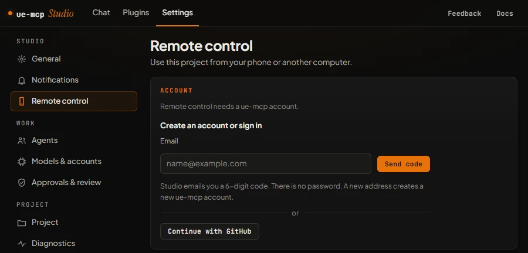
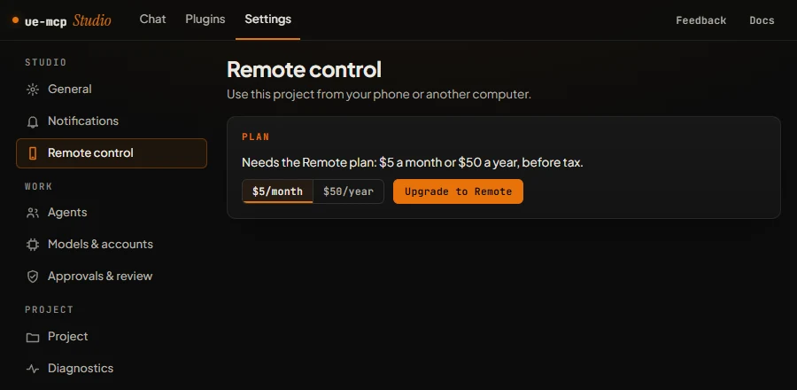
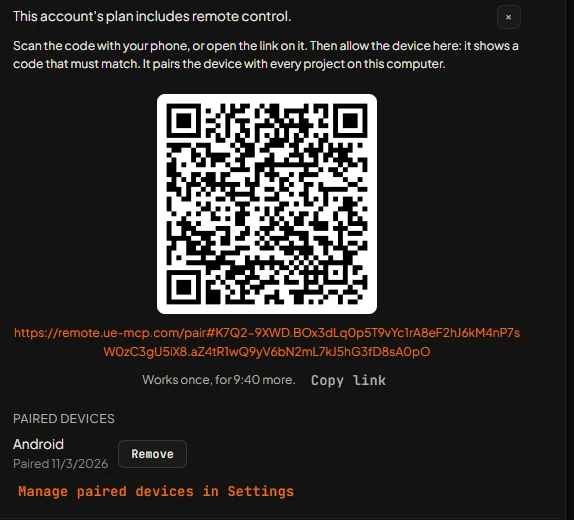
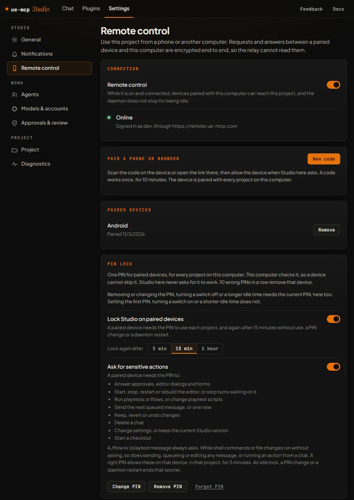
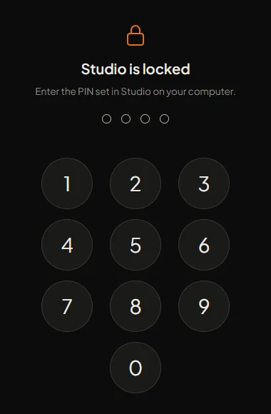

# Remote control

Remote control lets you use [Studio](studio.md) from a phone or another computer. The project, the editor and the agent stay on the computer running Studio. The paired device sends requests and shows the answers. Traffic between them is encrypted end to end through the relay at `remote.ue-mcp.com`, so the relay cannot read it.

Remote control needs the Remote plan: $5 a month or $50 a year, plus tax. Studio and ue-mcp are free and open source under the MIT license. See [ue-mcp.com/pricing](https://ue-mcp.com/pricing).

## Requirements

- Studio 0.1.25 or later on the computer running the project. See [Install](studio.md#install).
- A ue-mcp account with the Remote plan.
- A web browser on the device. An Android app is in testing.

The computer has to stay on, with Studio's ue-mcp daemon running and remote control connected.

## 1. Sign in

Open **Settings > General** and choose **Sign in to your ue-mcp account** in the **Account** card. **Settings > Remote control** shows the same sign-in while you are signed out.

- **Email:** Studio emails a 6-digit code, valid for 10 minutes. There is no password.
- **GitHub:** approve in your browser, or enter the code Studio shows on GitHub.

The first sign-in creates the account. You can link the other sign-in method later in the same card, and the plan stays with the account either way. From a terminal, `npx ue-mcp login --email <address>` or `npx ue-mcp login --github` signs in to the same account.

## 2. Upgrade

Type `/remote` in a chat, or open **Settings > Remote control**. Pick monthly or yearly and choose **Upgrade to Remote**. Stripe checkout opens in your browser.

Studio picks up the plan a few seconds after payment, with no restart. If the account already has a subscription, its billing page opens instead.

## 3. Turn it on

Remote control is on or off per project.

- `/remote` turns it on for the current project and waits up to 30 seconds for it to connect.
- **Settings > Remote control** has the **Remote control** switch, with its state below: **Off**, **Connecting**, **Online** or **Not connected**.

While it is on, paired devices can reach the project and the daemon does not stop when idle. While it is off, they cannot.

## 4. Pair a device

Remote control has to be **Online** first.

1. Get a code: `/remote` shows one once it connects, or choose **New code** under **Pair a phone or browser** in Settings.
2. Scan the QR code with the device, or open the link on it. **Copy link** copies it.

A code works once, for 10 minutes. One pairing covers every project on that computer.

## 5. Allow it on the computer

Studio on the computer asks whether to allow the device, and shows a 6-digit code. The device shows a code too. Choose **Allow** only if they match, otherwise **Deny**. You have 2 minutes; after that, make a new code.

An allowed device can use Studio in every project on the computer. It is listed under **Paired devices** in **Settings > Remote control**, where **Remove** unpairs it.

Remote control, pairing and the PIN lock can only be changed on the computer, not from a paired device.

## PIN lock

**PIN lock** in **Settings > Remote control** sets one PIN of 4 to 8 digits for all paired devices and every project on the computer. The computer checks it, so a device cannot skip it, and Studio on the computer itself never asks for it. 10 wrong PINs in a row remove the device; pair it again if that was you.

Two switches choose when a device asks:

- **Lock Studio on paired devices:** the PIN is needed to open each project, and again after a set time without use (**Lock again after**: 5 minutes, 15 minutes or 1 hour), a PIN change or a daemon restart.
- **Ask for sensitive actions:** the PIN is needed to answer approvals, dialogs and forms, control the editor, run playtests or flows, keep or revert changes, delete a chat, change settings or start a checkout. Settings lists every action. A correct PIN unlocks these on that device, in that project, for 5 minutes.

Removing or changing the PIN, turning a switch off or choosing a longer idle time needs the current PIN. **Forgot PIN** removes the PIN and unpairs every device.

## Notifications

Paired devices can show Studio's notifications. **Settings > Notifications** on each device sets whether it shows them, what they include, quiet hours and muted projects.

## Manage or cancel

**Manage plan** in **Settings > General > Account** opens the billing portal, where you can switch between monthly and yearly or cancel. Studio picks up the change within 3 minutes, or as soon as you open Settings.
