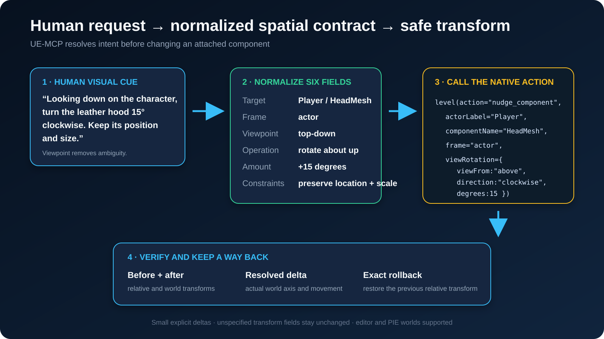
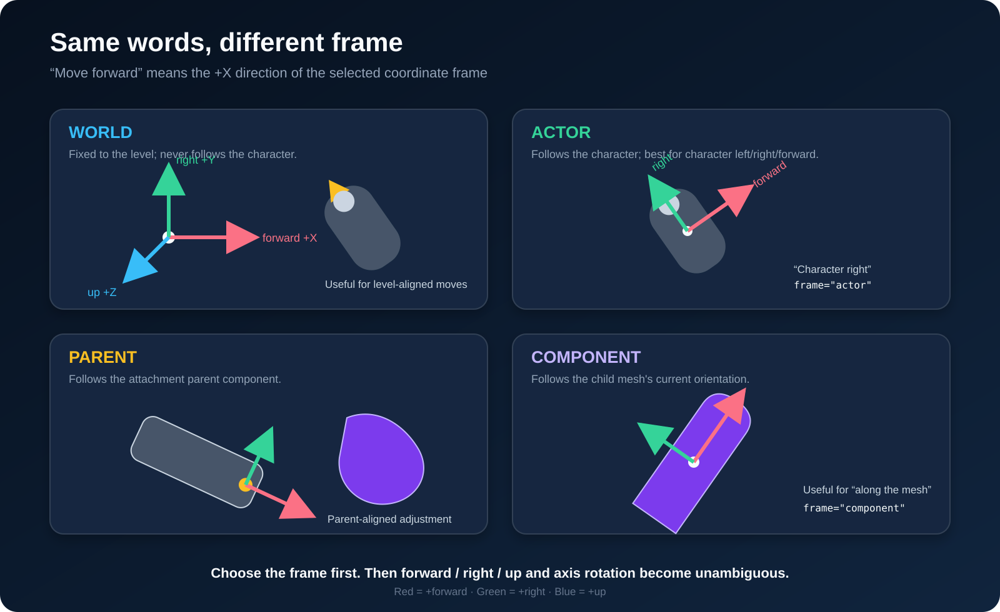
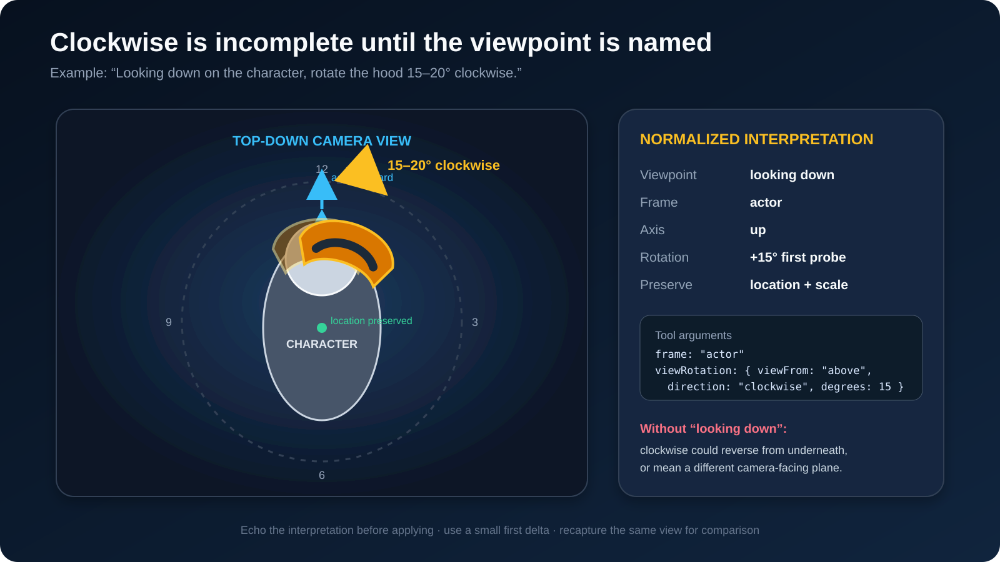
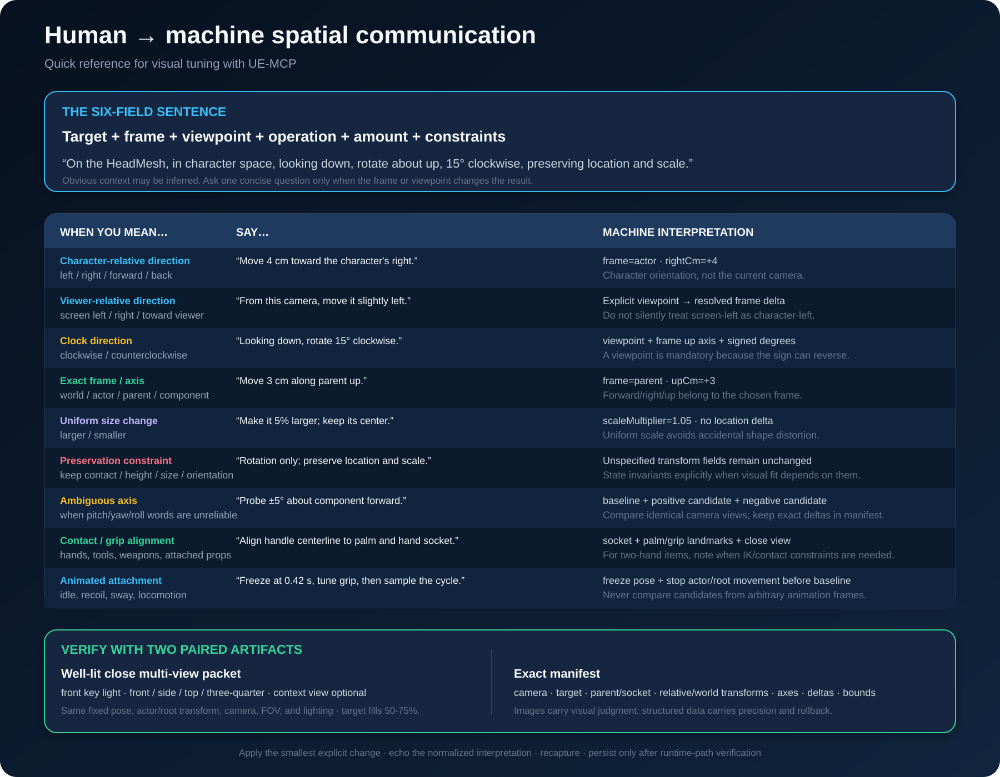

# Spatial instructions

A person says "turn the hood a bit clockwise". An editor needs an axis, an angle,
a coordinate frame, and a statement of what must not move. This page maps one to
the other.

The failure it prevents is silent. A raw relative Euler edit on an attached or
socketed component changes axes nobody asked about, reports success, and only
shows up later in a screenshot.

## The six-field sentence

Every spatial request normalizes to six fields. With all six known, the transform
is unambiguous.



| Field | Answers | Example |
|---|---|---|
| Target | Which actor, and which component on it | `Player` / `HeadMesh` |
| Frame | Whose axes | `actor` |
| Viewpoint | Looking from where | looking down |
| Operation | Translate, rotate, or scale | rotate about up |
| Amount | How much, in real units | 15 degrees clockwise |
| Constraints | What must not change | preserve location and scale |

Most requests supply three or four fields and imply the rest. Infer what is
obvious. Ask only when a missing field changes the result, which in practice
means frame or viewpoint.

## Frame: whose axes?

"Move forward" means +X **of the selected frame**. The same words produce four
different moves.



- **world** is fixed to the level. Use it for level-aligned moves: "line it up
  with the wall".
- **actor** follows the character, and is the default. This is what a person
  means by left, right, forward and back when talking about a character.
- **parent** is the attachment parent component's frame. The socket is not part
  of it; the result reports the socket separately.
- **component** is the component's own current orientation: "push it further
  along the way it already points".

"The character's right" means `frame="actor"`, not the camera the person is
looking through. Screen left and right need the camera viewpoint.

## Viewpoint: clockwise needs one

Clockwise is a property of a rotation **plus** the side it is viewed from. The
same rotation is clockwise from one side and counterclockwise from the other.



"Rotate it clockwise" is not yet an instruction. "Looking down on the character,
rotate it 15 degrees clockwise" is: it names the axis (actor up) and the sign.
If a request says clockwise without a viewpoint, ask for it.

## Phrase book



## Doing it

`level(nudge_component)` takes the normalized fields directly and composes a
quaternion delta instead of writing Euler angles, so an attached or socketed
component does not drift on axes nobody mentioned.

```text
level(action="nudge_component",
      actorLabel="Player",
      componentName="HeadMesh",
      frame="actor",
      viewRotation={ viewFrom: "above", direction: "clockwise", degrees: 15 },
      dryRun=true)
```

| Parameter | Meaning |
|---|---|
| `actorLabel` or `actorPath` | The actor; `actorPath` is unambiguous |
| `componentName` | Exact SceneComponent name |
| `frame` | `world`, `actor` (default), `parent`, `component` |
| `translationDelta` | `{forwardCm, rightCm, upCm}` along the frame's axes |
| `axisRotation` | `{axis: forward\|right\|up, degrees}`, signed |
| `viewRotation` | `{viewFrom, direction: clockwise\|counterclockwise, degrees}`, degrees greater than zero |
| `scaleMultiplier` | Uniform multiplier on relative scale, greater than zero |
| `dryRun` | Preview without writing (default false) |
| `world`, `pieInstance` | `editor` (default) or `pie`, and which PIE world |

`axisRotation` and `viewRotation` are mutually exclusive.

`dryRun=true` changes nothing. It returns the component path, attachment parent
and socket, absolute location/rotation/scale flags, bounds, relative and world
transforms with quaternions, the frame's world axes, and the requested world
location, rotation and relative scale. `operationApplied=false` means preview,
never a completed edit. With no deltas, a dry run is a spatial inspection call.

`viewFrom` names the observer's side **in the selected frame**, looking toward
the target. It does not read the player or editor camera:

| View from | Observer side | Rotation axis | Clockwise signed degrees |
|---|---|---|---|
| front | +X | forward | positive |
| back | -X | forward | negative |
| right | +Y | right | positive |
| left | -Y | right | negative |
| above | +Z | up | positive |
| below | -Z | up | negative |

Counterclockwise reverses the sign. The result reports the resolved
`rotationAxis` and signed `rotationDegrees`. Use `viewRotation` and let the
handler pick the sign rather than guessing one for `axisRotation`.

Echo the resolved target, frame, viewpoint and amount in plain language. If they
match the request, repeat the call with `dryRun=false`. The preview reports the
**requested setter inputs**, not a guaranteed final transform: socket attachment,
absolute flags, scale, physics and construction scripts can change the result.
Read the applied call's `after` transforms. Its rollback is a
`level(restore_component_transform)` call with the previous relative transform.

Translation is in centimetres along the frame's forward, right and up. Scale is a
uniform multiplier. Rotation is an axis and an angle, never three Euler numbers.

## Verifying

A successful transform write is not visual verification. Read the returned
transform, and for anything a person will look at, capture images.

`editor(capture_scene_png)` returns `captureMetadata` with each image: camera
location, rotation and basis, FOV, image size, world and PIE instance, world
time, the texture-loading setting and the focus target. Keep it beside the image.
`editor(get_viewport_state)`, `editor(set_viewport_exposure)` and
`editor(hit_test_viewport_pixel)` act on the editor viewport, not this separate
SceneCapture2D, so do not use the viewport's pixel hit test to locate a point in
a headless capture.

Frame the capture so the contact region fills half to three quarters of the
shot, light it, and take matching views from several angles: front, side, top,
three-quarter. Do not infer 3D contact from one image.

When the target is attached to a character, stop the actor and freeze the parent
skeletal pose before the baseline capture, and hold both across every probe.
Otherwise the comparison measures the animation instead of the edit.

## When to ask

Ask when the answer changes the transform:

- clockwise or counterclockwise with no viewpoint
- left or right when it is unclear whether the character or the camera is the
  reference
- an attached component, where the frame decides whether the parent carries the
  change

Do not ask when context settles it. "Move the character's arm forward 5 cm" has
a target, a frame, an operation and an amount; a viewpoint does not affect a
translation.
