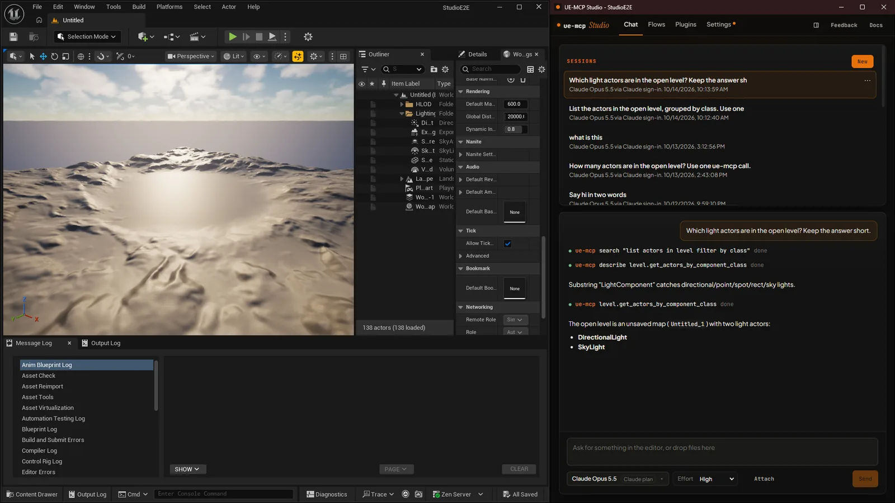
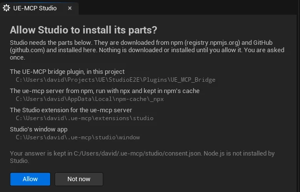
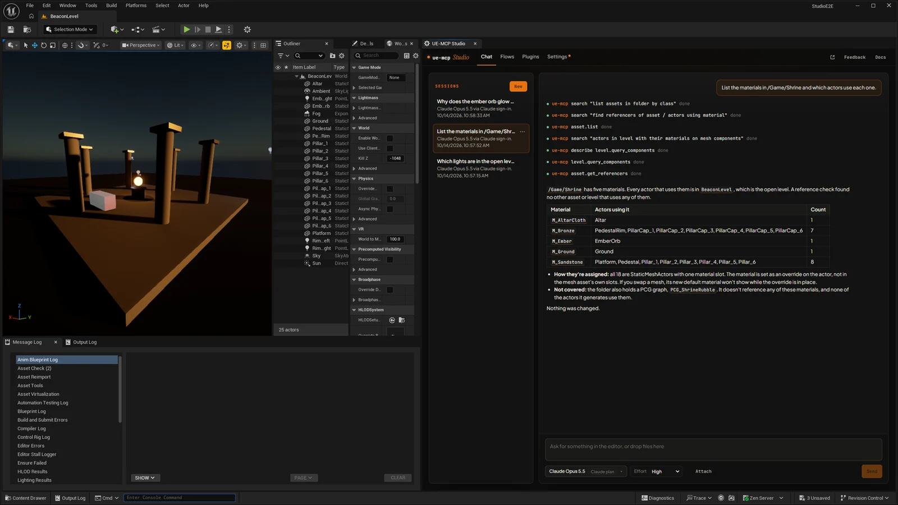
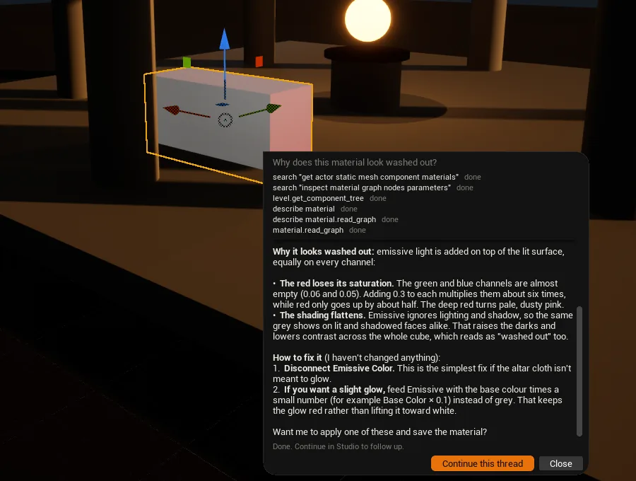
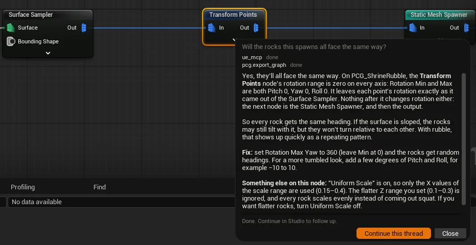

# UE-MCP Studio

UE-MCP Studio is an agent that works inside Unreal Editor through ue-mcp's actions. You chat with it in a window beside the editor or docked in an editor tab, and it reads and changes your project with the same actions an MCP client gets. Studio is free. Its source is open under the MIT license on GitHub; the copy you get from Fab is licensed under the Fab EULA (Standard License).

Studio comes in three parts:

- **The UE_MCP_Studio editor plugin**, from Fab. It adds the **Studio** toolbar button, **Tools > UE-MCP Studio**, the **UE-MCP Studio** tab with the setup page and a status view, and the **UE-MCP Docs** tab. It starts the project's ue-mcp daemon.
- **ue-mcp and its bridge plugin.** The daemon runs the MCP server for the project, and the bridge plugin connects it to the editor.
- **The Studio extension**: the agent, its UI and `studio-window.exe`, Studio's own window. The ue-mcp daemon loads the extension and serves the UI.

Studio runs in a separate process from the editor, so the chat keeps working while the editor is busy. A long generation or a blocking call shows as "Editor busy" with a timer and a Stop button instead of freezing the chat.



## Prerequisites

- Windows 10 or 11.
- Unreal Engine 5.7 or 5.8.
- [Node.js](https://nodejs.org/) 20 or newer. Install the LTS release from the Node.js website with its Windows installer, using the default options. Studio does not install Node.js; when it is missing, the setup page opens the Node.js download page.
- The Microsoft Edge WebView2 Runtime, which Windows 11 includes. On Windows 10, if it is not already installed, get the Evergreen Runtime from [Microsoft's WebView2 page](https://developer.microsoft.com/en-us/microsoft-edge/webview2/). Without it, Studio opens in your web browser instead of its own window.
- An account or API key for at least one model provider (see [Models and sign-in](#models-and-sign-in)).

Studio's own setup does not compile anything: Fab supplies the Studio plugin already built, and Studio installs the bridge as prebuilt binaries for your engine. Visual Studio with the **Desktop development with C++** workload is needed only to build the bridge from source, for example when your project already has a source install of the bridge, which the editor builds when it starts. Get it from the [Visual Studio download page](https://visualstudio.microsoft.com/downloads/) and pick that workload in the Visual Studio Installer.

## Install from Fab

1. Add **UE-MCP Studio** to your library on Fab.
2. In the Epic Games Launcher, install it to your Unreal Engine 5.7 or 5.8 from your Fab Library.
3. Open your project, then enable **UE-MCP Studio** in **Edit > Plugins** and restart the editor when asked.
4. Open Studio with the **Studio** toolbar button or **Tools > UE-MCP Studio**. The console command `Studio.Open` does the same.

## First start

### Consent

The first time you open Studio, the **UE-MCP Studio** tab asks **Allow Studio to install its parts?** Nothing is downloaded or installed until you choose **Allow**. **Not now** closes the tab and records nothing, so Studio asks again the next time you open it.



The prompt lists each part and the folder it goes to:

| Part | Where it goes | Downloaded from |
|---|---|---|
| The UE-MCP bridge plugin | `<YourProject>/Plugins/UE_MCP_Bridge` | GitHub releases of ue-mcp |
| The ue-mcp server, run with `npx` | npm's cache, `%LOCALAPPDATA%\npm-cache\_npx` | registry.npmjs.org |
| The Studio extension | `%USERPROFILE%\.ue-mcp\extensions\studio` | GitHub releases of ue-mcp-studio |
| Studio's window app | `%USERPROFILE%\.ue-mcp\studio\window` | Part of the Studio extension |

Your answer is kept per user in `%USERPROFILE%\.ue-mcp\studio\consent.json`, so you are asked once on each machine. If Studio was already installed before the prompt existed, that install keeps working and the file is written for you.

### Setup page

After **Allow**, the tab shows the setup page with three steps.

1. **Dependencies.** Without Node.js, the page offers **Download**, which opens the Node.js download page in your browser, and **Check again** for when the installer has finished.
2. **Bridge.** **Install** runs `ue-mcp init` for the project. It installs the bridge plugin as prebuilt binaries, enables the plugins it needs in your `.uproject` (`UE_MCP_Bridge`, `PythonScriptPlugin` and the engine plugins its tool categories use), creates `ue-mcp.yml` in the project folder, and adds `ue-mcp.local.yml` to `.gitignore`. **Options** shows the setup choices before you install: other MCP clients found on this machine to connect as well (a client whose config applies to every project is never chosen for you), and on Unreal Engine 5.8, whether to turn on the engine's native Unreal tools beside the bridge. The bridge loads without a restart when every engine plugin it needs is already loaded; otherwise the page asks you to restart the editor once.
3. **MCP server.** The plugin downloads the Studio extension and starts the project's ue-mcp daemon. This takes a few seconds the first time.

Progress is written to `<YourProject>/Saved/Logs/UE_MCP_Studio.log`, and the page shows that path.

Once the daemon is up, the tab shows the status view: the daemon's ue-mcp version and port, whether the editor is connected to Studio, whether the window is open or docked, and whether updates are ready. From then on the plugin starts the daemon with the editor. The daemon keeps running after the editor closes.

## Models and sign-in

Pick a model in the chat box, or in **Settings > General > Model**. Each vendor connects through its own sign-in where it offers one, and through your API key where it does not.

| Vendor | Sign-in | API key |
|---|---|---|
| Anthropic | None | Yes |
| OpenAI | **ChatGPT** | Yes |
| Google | None | Yes |

- **ChatGPT.** You approve the sign-in in your browser, and OpenAI models run on your ChatGPT plan's limits.
- **API keys.** Paste a key under **Settings > General > API keys**. A model runs on your key only when no sign-in runs it. Keys are kept on this machine, in `%USERPROFILE%\.ue-mcp\studio\keys`, and every project uses them.

Sign-in tokens are kept in `%USERPROFILE%\.ue-mcp\studio` and shared by every project.

## Commands and edits

The agent works in the editor through ue-mcp, and on your machine through Studio's own tools: `shell` (Git Bash when Git is installed, otherwise PowerShell), `read_file`, `write_file`, `edit_file`, `glob`, `grep` and `web_fetch`, plus the model provider's own web search where the route has one. Commands run in the project folder, and relative paths start there.

Reads, searches and fetches run without asking. A shell command, a file write or a file edit waits in the chat, showing the command or the diff, until you choose:

- **Allow** runs this one call.
- **Allow for this session** runs it and stops asking for that kind of call for the rest of the session. Commands and file changes are allowed separately.
- **Deny** does not run it, and the agent is told you declined.

Stopping the turn while a call waits answers it as stopped, and it does not run.

**Settings > Agent > Ask before running commands and editing files** turns the asking on or off for the project. It is on by default. Calls the agent makes to the editor through ue-mcp do not go through these approvals.

**Settings > Agent > Editor dialogs** sets who answers a dialog that one of the agent's editor calls opens.

## Docked or window

Studio opens in its own window. The window stays above the editor while either is in front, minimizes and restores with it, and remembers its place for each project.

**Dock in editor**, in Studio's header or in the **UE-MCP Studio** tab, shows Studio in that tab instead, beside Details by default. Docked, it is still its own process, held over the tab: it moves, resizes, floats and hides with the tab like any other panel. **Open as window** brings it back out. The choice is kept per project. When the tab is part of your saved editor layout, Studio appears in it on editor start.



### Ask Studio from the editor

- **Ctrl+Alt+Space**, or **Ctrl+Alt+right-click** over the level viewport or a graph, opens a one-line prompt at the cursor that starts a new Studio session. It carries what is under the cursor as context. The shortcut can be changed in **Editor Preferences > Keyboard Shortcuts** under **Ask Studio**.
- **Chat about this**, in the context menu of selected actors or assets, opens the same prompt with them as context.





The prompt shows the reply, with **Stop** and **Continue this thread**, which opens the session in Studio.

## Updates

- **The editor plugin** installed from Fab updates through your Fab Library in the Epic Games Launcher. The plugin records at startup that it is the Fab build, in `<YourProject>/Saved/UE_MCP_Studio/plugin.json`, and Studio never replaces a plugin that reports itself as the Fab build. When a Studio release needs a newer plugin, Studio says so and points you to the Fab Library.
- **Studio and ue-mcp** update in the app. **Settings > General > Updates** lists Studio, the editor plugin and ue-mcp with the installed and latest versions, and **Update** installs what is ready. The plugin also checks for a newer Studio extension each time the editor starts.
- An update that restarts ue-mcp or the editor waits until no turn is running. **Restart now** installs it at once and stops the turn.
- The **Channel** setting picks **Stable** or **Beta**. Beta also takes prereleases, for testing.

## Uninstall

1. Close Studio, then stop the project's daemon, which keeps running after the editor closes. From the project folder:

    ```bash
    npx ue-mcp daemon stop
    ```

2. Disable **UE-MCP Studio** in **Edit > Plugins** for each project that uses it, then close the editor. To remove the plugin from your engine, remove it through your Fab Library in the Epic Games Launcher.
3. Delete `<YourProject>/Plugins/UE_MCP_Bridge` and `<YourProject>/Saved/UE_MCP_Studio`, and remove the `UE_MCP_Bridge` and `UE_MCP_Studio` entries from the `Plugins` list in your `.uproject`. Delete `ue-mcp.yml` from the project folder if you do not use ue-mcp otherwise.
4. Delete Studio's per-user folders:
    - `%USERPROFILE%\.ue-mcp\extensions\studio`: the Studio extension.
    - `%USERPROFILE%\.ue-mcp\studio`: the window app, sign-ins, API keys, the update channel and the consent record.
    - `%USERPROFILE%\.ue-mcp\data`: per-project data, including Studio's settings and sessions.
    - `%USERPROFILE%\.ue-mcp\daemons`: the daemons' discovery files.

    If you do not use ue-mcp for anything else, delete all of `%USERPROFILE%\.ue-mcp`.
5. Optionally, delete npm's `npx` cache at `%LOCALAPPDATA%\npm-cache\_npx`. It holds the ue-mcp package and anything else you ran with `npx`.

## Source

- Editor plugin: [db-lyon/ue-mcp-studio-plugin](https://github.com/db-lyon/ue-mcp-studio-plugin)
- Studio extension: [db-lyon/ue-mcp-studio](https://github.com/db-lyon/ue-mcp-studio)
- ue-mcp and the bridge plugin: [db-lyon/ue-mcp](https://github.com/db-lyon/ue-mcp)
